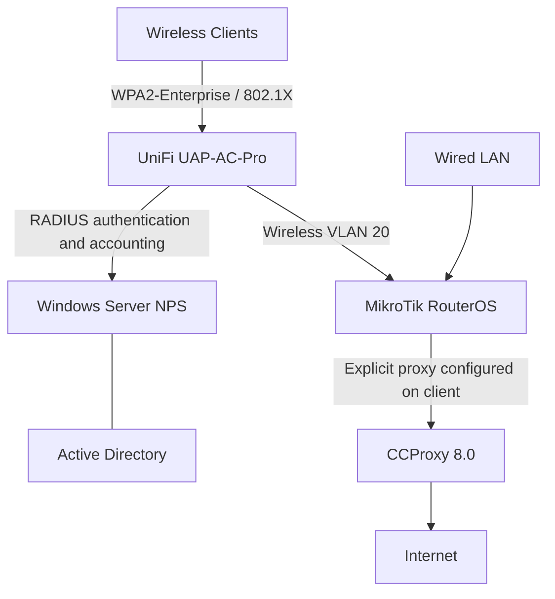

# Pilot Enterprise Network Infrastructure

**Purbani Group | Internship / Practicum Project**

A report-based documentation repository for the practicum project:

> **“Study and Pilot-Level Implementation of a MikroTik, Proxy Server and RADIUS-Based Network Infrastructure with Improvement at Purbani Group.”**

This repository documents the network infrastructure work described in the internship report, with emphasis on centralized wireless authentication, network segmentation, routing, proxy access control, and monitoring.

---

## Project Overview

The documented pilot infrastructure brings together the following components:

- **MikroTik RouterOS** — LAN/WAN connectivity, bridge and VLAN interfaces, IP addressing, DHCP, DNS, NAT, routing, and RIP configuration.
- **Windows Server NPS / RADIUS** — centralized network authentication and accounting, integrated with Active Directory.
- **Active Directory Domain Services (AD DS)** — domain users and the wireless-access security group.
- **Ubiquiti UniFi UAP-AC-Pro** — wireless access using WPA2-Enterprise / 802.1X with RADIUS.
- **CCProxy 8.0** — explicit proxy authentication, website filtering, and connection monitoring.

### Wireless VLAN documented in the report

| Setting | Value |
|---|---|
| VLAN ID | `20` |
| Subnet | `20.20.20.0/24` |
| Gateway | `20.20.20.1` |
| RADIUS authentication port | `1812/UDP` |
| RADIUS accounting port | `1813/UDP` |

---

## Network Architecture

The following diagram summarizes the main components and their documented relationships.



> **Architecture note:** The report documents a browser proxy-authentication prompt for CCProxy. This supports explicit proxy use by the tested browser; it does not by itself prove transparent interception or mandatory proxying of all network traffic.

---

## Complete Chapter 07-to-End Documentation

The detailed report-ordered documentation is available here:

**[Read Chapter 07–12 Complete Documentation](docs/CHAPTER-07-TO-END-COMPLETE.md)**

It covers the implementation steps, settings, report evidence, figure index, and references recorded in the internship report.

| Chapter | Main coverage |
|---|---|
| Chapter 07 | Windows NPS, RADIUS clients, Active Directory users and groups, network policies, PEAP, VLAN attributes, accounting |
| Chapter 08 | MikroTik interfaces, bridge, VLANs, IP addressing, DNS, DHCP, NAT, IP pools, routing, RIP, connectivity test |
| Chapter 09 | UniFi account, UAP-AC-Pro adoption, wireless network, WPA2-Enterprise, RADIUS profile, VLAN and client monitoring |
| Chapter 10 | CCProxy 8.0 services and ports, LAN account, web filtering, connection information and browser authentication |
| Chapter 11 | Network architecture, VLAN 20, authentication flow, MikroTik routing/DHCP/NAT and CCProxy integration |
| Chapter 12 | Conclusion |

The documentation also includes the report's reference list and a figure index for Figures 7.1–11.1.

---

## Repository Structure

```text
.
├── README.md
├── docs/
│   └── CHAPTER-07-TO-END-COMPLETE.md
├── diagrams/
│   └── network-architecture.mmd
├── mikrotik/
│   └── NOTES.md
├── windows-nps/
│   └── NOTES.md
├── unifi/
│   └── NOTES.md
├── ccproxy/
│   └── NOTES.md
├── kaspersky/
│   └── endpoint-protection.md
├── tests/
│   └── VALIDATION.md
└── evidence/
    └── README.md
```

---

## Validation and Evidence

Use the checklist in **[tests/VALIDATION.md](tests/VALIDATION.md)** to record any repeat testing. Add authorized, sanitized screenshots to the `evidence/` directory and use descriptive filenames that correspond to the report's figure numbers where possible.

Do not mark a test as passed unless it has actually been repeated and verified.

---

## Kaspersky — Proposed Extension

Kaspersky is cited in the internship report as an information source about IP addresses. The report chapters do **not** document Kaspersky installation, licensing, endpoint deployment, policy configuration, or testing.

For that reason, **[kaspersky/endpoint-protection.md](kaspersky/endpoint-protection.md)** is clearly labelled as a proposed future security extension, not as part of the completed implementation.

---

## Scope and Accuracy

This repository is a documentation of a **pilot-level practicum implementation**. It is not a production-ready deployment bundle and does not include:

- Actual passwords or RADIUS shared secrets
- Full MikroTik configuration exports
- Windows Server backups
- Software installers or license keys

Some exact values, such as the wireless SSID and the NPS time restrictions, are not transcribed in the report and are therefore not invented here. Refer to the detailed chapter documentation for the report-supported configuration information.

---

## Security and Privacy

Before making this repository public:

1. Review all IP addresses and infrastructure details.
2. Remove passwords, shared secrets, license keys, and private credentials.
3. Redact personal information and sensitive details from screenshots.
4. Confirm that you are authorized to publish company-related information and evidence.

---

## Project Topics

`MikroTik` · `RouterOS` · `Enterprise Networking` · `Windows Server` · `NPS` · `RADIUS` · `Active Directory` · `UniFi` · `WPA2-Enterprise` · `802.1X` · `VLAN` · `CCProxy` · `Proxy Server` · `Network Security` · `Network Administration`
